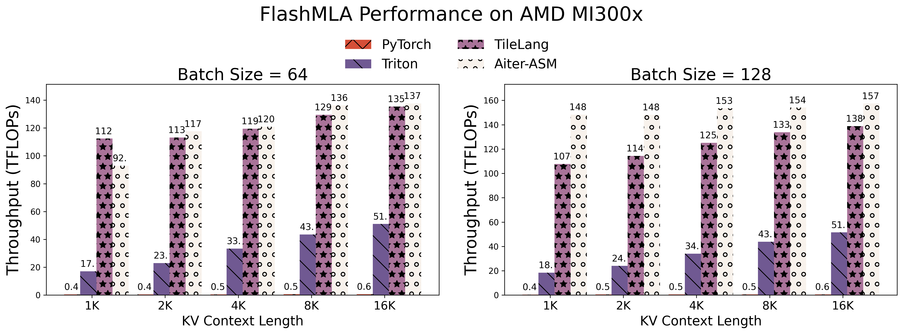

# 🚀 使用 TileLang 在 Hopper 上编写高性能 FlashMLA

<div style="text-align: left;">
    <em>Author:</em> <a href="https://github.com/chengyupku">Yu Cheng</a>
    <em>Author:</em> <a href="https://github.com/LeiWang1999">Lei Wang</a>
</div>

TileLang 是一种用户友好的 AI 编程语言，它显著降低了内核编程的门槛，帮助用户快速构建定制化算子。然而，用户仍需掌握一定的编程技巧，以更好地发挥 TileLang 的强大能力。在这里，我们将以 MLA 为例，展示如何使用 TileLang 编写高性能内核。

## MLA 简介

DeepSeek 的 MLA（Multi-Head Latent Attention，多头潜在注意力）是一种新颖的注意力机制，以其硬件高效性和显著提升模型推理速度而著称。多个深度学习编译器（如 [Triton](https://github.com/triton-lang/triton)）和库（如 [FlashInfer](https://github.com/flashinfer-ai/flashinfer)）已经开发了各自的 MLA 实现。2025 年 2 月，[FlashMLA](https://github.com/deepseek-ai/FlashMLA) 在 GitHub 上开源。FlashMLA 利用 [CUTLASS](https://github.com/NVIDIA/cutlass) 模板，并融合了 [FlashAttention](https://github.com/Dao-AILab/flash-attention) 的优化技术，实现了出色的性能表现。

## 基准测试结果

我们在批量大小（batch size）为 64 和 128、数据类型为 float16 的条件下，对 FlashMLA、TileLang、Torch、Triton 和 FlashInfer 的性能进行了基准测试，结果如下图所示。

```{figure} ../../_static/img/mla_hopper/bs64_float16.png
:width: 50%
:alt: Overview
:align: center

Figure 1: Performance under batch size=64
```

```{figure} ../../_static/img/mla_hopper/bs128_float16.png
:width: 50%
:alt: Overview
:align: center

Figure 2: Performance under batch size=128
```

如结果所示，TileLang 在大多数场景下达到了与 FlashMLA 相当的性能，显著优于 FlashInfer 和 Triton。
值得注意的是，**TileLang 仅用约 80 行 Python 代码就实现了这一目标**，充分展现了其卓越的易用性和高效性。接下来让我们深入了解 TileLang 是如何做到的。

## 实现

首先，让我们回顾传统 FlashAttention 的核心计算逻辑：

```python
# acc_s: [block_M, block_N]
# scores_max: [block_M]
# scores_scale: [block_M]
# acc_o: [block_M, dim]

for i in range(loop_range):
    acc_s = Q @ K[i]
    scores_max_prev = scores_max
    scores_max = max(acc_s, dim=1)
    scores_scale = exp(scores_max_prev - scores_max)
    acc_o *= scores_scale
    acc_s = exp(acc_s - scores_max)
    acc_o = acc_s @ V[i]
    ...
```

其中，`acc_s` 表示每次迭代中 `Q @ K` 的结果，维度为 `[block_M, block_N]`；`acc_o` 表示当前迭代的输出，维度为 `[block_M, dim]`。`acc_s` 和 `acc_o` 都需要存储在寄存器中以降低延迟。

与传统的注意力算子（如 MHA（Multi-Headed Attention，多头注意力）或 GQA（Grouped Query Attention，分组查询注意力））相比，优化 MLA 的一个主要挑战在于其较大的头维度——`query` 和 `key` 的头维度为 576（512 + 64），而 `value` 的头维度为 512。这带来了一个重要问题：`acc_o` 变得过大，在线程数不足（如 128 个线程）的情况下会发生寄存器溢出（register spilling），严重影响性能。

这就引出了如何对矩阵乘法操作进行分区的问题。在 Hopper 架构上，大多数计算内核使用 [`wgmma.mma_async`](https://docs.nvidia.com/cuda/parallel-thread-execution/#asynchronous-warpgroup-level-matrix-instructions) 指令以获得最佳性能。`wgmma.mma_async` 指令将 4 个 warp（128 个线程）组织成一个 warpgroup 进行集体 MMA 运算。然而，`wgmma.mma_async` 指令要求 M 维度最小为 64。这意味着每个 warpgroup 的最小 M 维度只能缩减到 64，但对于单个 warpgroup 而言，64×512 的分块大小过大，会导致寄存器溢出。

因此，我们唯一的选择是沿 `dim` 维度对 `acc_o` 进行分区，由两个 warpgroup 分别计算 `acc_o` 的左半部分和右半部分。然而，这又引入了另一个挑战：两个 warpgroup 都需要完整的 `acc_s` 结果作为输入。

我们的解决方案是让每个 warpgroup 在 `Q @ K` 计算过程中各自计算 `acc_s` 的一半，然后通过共享内存获取另一个 warpgroup 计算的另一半。

### 布局推断

虽然上述过程看起来很复杂，但别担心——TileLang 会为您处理所有这些细节。

图 3 和图 4 展示了 MLA 的前端 TileLang 脚本及其对应的执行计划。其中，`T.gemm` 表示矩阵乘法操作，`transpose_B=True` 表示对矩阵 B 进行转置，`policy=FullCol` 指定每个 warpgroup 计算一列（即沿垂直维度拆分结果矩阵）。`T.copy` 表示缓冲区之间的拷贝操作。

```{figure} ../../_static/img/mla_hopper/qk_layout.jpg
:width: 50%
:alt: Overview
:align: center

Figure 3: Buffer shapes in Q @ K
```

```{figure} ../../_static/img/mla_hopper/pv_layout.jpg
:width: 50%
:alt: Overview
:align: center

Figure 4: Buffer shapes in acc_s @ V
```

从 TileLang 前端代码到执行计划的映射是通过布局推断（Layout Inference）来完成的。布局推断是 TileLang 的核心优化技术，它根据 Tile 算子（如 `T.gemm`、`T.copy` 等）自动推导所需的缓冲区形状和最优布局，然后生成相应的代码。下面我们通过 MLA 中缓冲区形状推断的具体示例来说明。

例如，在计算 `Q @ K` 时，TileLang 根据 `T.gemm` 中的 `policy=FullCol` 注解推断出每个 warpgroup 的 `acc_s_0` 形状应为 `[blockM, blockN / 2]`。由于后续的 `acc_s @ V` 操作同样使用 `policy=FullCol`，需要每个 warpgroup 拥有完整的 `acc_s` 结果，因此 TileLang 推导出此时 `acc_s` 的形状应为 `[blockM, blockN]`。进而，TileLang 可以继续向前推断，确定 `T.copy(S_shared, acc_s)` 中的 `S_shared` 和 `acc_s` 形状均为 `[blockM, blockN]`。

值得注意的是，我们的调度方式与 FlashMLA 的实现策略有所不同。在 FlashMLA 中，`Q @ K` 被分配给单个 warpgroup，而 `acc_o` 的分区方案与我们一致。尽管如此，我们的调度方式仍然实现了相当的性能。

### 线程块交叉调度

线程块交叉调度（Threadblock Swizzling）是 GPU 内核优化中常用的性能优化技术。在 GPU 架构中，L2 缓存是多个 SM（Streaming Multiprocessor，流式多处理器）共享的高速缓存。线程块交叉调度通过重新映射线程块的调度顺序来优化数据访问模式，从而提高 L2 缓存命中率。传统调度通常按照网格的自然顺序执行线程块，这可能导致相邻线程块之间的数据访问模式不连续，造成缓存数据利用率低下。Swizzle 技术采用数学映射方法（如对角映射或交错映射）来调整线程块的执行顺序，确保连续调度的线程块访问相邻或重叠的数据区域。

在 TileLang 中，只需一行 Python 代码即可实现线程块交叉调度优化：

```python
T.use_swizzle(panel_size: int, order: str = "row")
```

其中，`panel_size` 指定交叉调度线程块组的宽度，`order` 决定交叉调度模式，可以是 "row" 或 "col"。

### 共享内存交叉调度

在 CUDA 编程中，共享内存被划分为多个内存 bank，每个 bank 在每个时钟周期内可以并行处理一个线程请求。当多个线程同时访问映射到同一 bank 的不同地址时，就会发生 bank 冲突（bank conflict），迫使这些访问被串行化，从而降低性能。

解决 bank 冲突的一种常见策略是共享内存交叉调度（Shared Memory Swizzling）。该技术通过重新映射地址来重新排列数据在共享内存中的存储方式，将原本映射到同一 bank 的地址重新分配到不同的 bank，从而减少冲突。例如，可以在地址计算中加入 XOR 运算或其他位操作来改变数据布局，使连续线程的内存访问更均匀地分布在各个 bank 上。这种方法对于实现矩阵乘法和卷积等高性能计算任务尤为关键，因为它可以显著提高内存访问的并行度和整体执行效率。

同样，TileLang 也支持共享内存交叉调度。用户只需添加一行 Python 代码：

```python
T.annotate_layout({
    S_shared: TileLang.layout.make_swizzled_layout(S_shared),
})
```

其中，`T.annotate_layout` 允许用户为缓冲区指定任意期望的布局。为方便起见，TileLang 提供了 `make_swizzled_layout` 原语来自动生成交叉调度布局。

### Warp 特化

Hopper 架构通常采用 Warp 特化（Warp-Specialization）进行性能优化。一种典型的方法是将一个 warpgroup 指定为生产者（producer），负责使用 TMA（Tensor Memory Accelerator，张量内存加速器）进行数据搬运，而其余 warpgroup 作为消费者（consumer）执行计算。然而，这种编程模式十分复杂，需要开发者手动管理生产者和消费者的执行逻辑，包括通过 `mbarrier` 对象进行同步。

在 TileLang 中，用户完全不需要关心这些实现细节。前端脚本会被自动转换为 Warp 特化形式，TileLang 自动处理所有生产者-消费者同步，实现高效计算。

### 流水线

流水线（Pipeline）是一种通过重叠内存访问和计算来提高内存访问效率的技术。在 TileLang 中，可以通过 `T.pipelined` 注解来实现流水线：

```python
T.pipelined(range: int, stage: int)
```

其中，`range` 指定流水线的范围，`stage` 指定流水线的阶段数。多阶段流水线可以实现计算与内存访问的重叠，对于内存密集型算子可以显著提升性能。但是，设置更多的阶段会消耗更多的共享内存资源，因此需要根据具体场景确定最优配置。

### Split-KV

我们还实现了类似于 [FlashDecoding](https://pytorch.org/blog/flash-decoding/) 的 Split-KV 优化。具体而言，当批量大小较小时，由于并行度不足，无法充分利用并行的 SM 资源。在这种情况下，我们可以将 kv_ctx 维度拆分到多个 SM 上进行并行计算，然后合并结果。

在我们的实现中，我们开发了 split 和 combine 两个内核，允许用户通过 `num_split` 参数控制拆分大小。

## 🚀 在 AMD MI300X 加速器上

在之前展示了[使用 TileLang 在 NVIDIA Hopper 架构上实现高性能 FlashMLA](https://github.com/tile-ai/tilelang/blob/main/examples/deepseek_mla/README.md) 之后，本节介绍针对 AMD MI300X 加速器的优化实现。我们将分析这两个平台之间的架构差异和相应的优化策略。

### 架构考量与优化策略

Hopper 与 MI300X 架构之间的主要实现差异包括：

1. **指令集差异**：MI300X 架构无需显式的张量内存访问（TMA）指令和 Warp 特化，这些在 Hopper 架构上由编译器自动处理，因此在源代码层面表现一致。

2. **共享内存约束**：MI300X 拥有 64KB 共享内存，相比 Hopper 的 228KB 较少，因此需要更精细的内存管理。我们的优化策略包括：
   - 减少软件流水线阶段数
   - 将 Q 矩阵缓存到寄存器而非共享内存中：
   ```python
   # Original shared memory allocation
   Q_shared = T.alloc_shared([block_H, dim], dtype)
   Q_pe_shared = T.alloc_shared([block_H, pe_dim], dtype)

   # Optimized register allocation
   Q_local = T.alloc_fragment([block_H, dim], dtype)
   Q_pe_local = T.alloc_fragment([block_H, pe_dim], dtype)
   ```

3. **分块大小灵活性**：由于 MI300X 上没有 WGMMA 指令，分块大小可以更灵活地选择，block_m 不再需要是 64 的倍数。

4. **内存 Bank 冲突交叉调度**：MI300X 与 NVIDIA 有不同的内存 bank 冲突规则，因此需要使用不同的交叉调度策略。这也由 TileLang 自动处理，在代码层面没有可见差异。

### 性能评估

我们使用 float16 精度、批量大小为 64 和 128 的配置，在多个框架之间进行了对比性能分析。实验结果如下：

<figure style="text-align: center">
  <a href="../../_static/img/flashmla-amd.png">
    
   </a>
  <figcaption style="text-align: center;">Figure 1: Computational throughput comparison across frameworks (Batch sizes 64 and 128)</figcaption>
</figure>

值得注意的是，TileLang 在大多数测试场景中达到了与手工优化汇编内核（aiter-asm）相当的性能，同时显著超越了 Triton（1.98 倍）和 PyTorch（3.76 倍）的实现。这一性能是通过简洁的 80 行 Python 代码实现的，充分展示了 TileLang 在效率和可编程性方面的优势。

### 未来优化方向

1. **内存 Bank 冲突缓解**：当前实现主要通过 TileLang 的自动优化解决 NT 布局中的 bank 冲突。针对其他内存布局的交叉调度技术的进一步研究仍是一个开放的研究方向。

2. **维度并行化**：对于较大的 MLA 维度（如 576 个元素），我们建议研究头维度分区策略，以：
   - 减少共享内存压力
   - 提高计算与内存访问的比率
   - 通过维度级任务分配增强并行度
